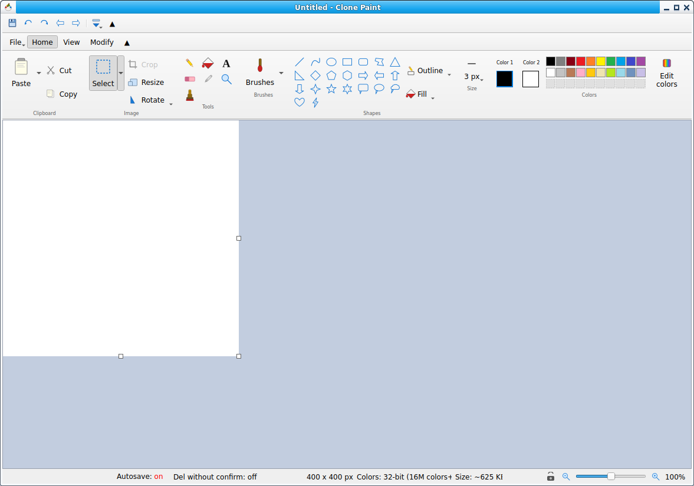

# clone_paint
2026-10-25-14-06-03

Clone Paint — Paint program with a familiar interface

Written in PyQT, and using plugins.



### features:

- familiar interface
- (optional) auto save
- navigate all image files in directory using mouse or left and right arrow
- jpegxl, webp, avif, heif support (using plugins, see above)
- save as pdf
- create pdf using multiple columns or rows of images (booklet like)
- recompress pdf (convert pages to image, compress, save as pdf, mostly for scanned images)
- extract pages from multipage formats (pdf and multipage tiff)

### how to install:

pip install -r requirements.txt
or
pip install --upgrade -r requirements.txt

requirements.txt:  
```
PyQt5>=5.6
pillow
# JPEG XL Pillow fallback (used when the Qt JXL plugin is absent)
pillow-jxl-plugin
# HEIF open/save (no Qt HEIF plugin bundled; Pillow plugin)
pillow-heif
# AVIF open/save (Pillow with libavif; Pillow>=11.2)
pillow[avif]
# PDF: Recompress images inside PDF, Extract pages from PDF without conversion (only needed for those features)
pypdf
# PDF: Extract pages from PDF with conversion (draws whole PDF pages; only needed for that feature)
pypdfium2

```

For jxl, if installed [qt-jpegxl-image-plugin](https://github.com/novomesk/qt-jpegxl-image-plugin) will be used, otherwise pillow-jxl-plugin converts the image temporarily from and to jxl.

For webp, if the Qt WebP plugin (qtimageformats qwebp) is installed it will be used, otherwise Pillow (built-in WebP support, no extra plugin) converts the image temporarily. 

WebP and JPEG XL save by default losslessly, or at quality 90 if 'Save JPEG XL/WebP lossless' is off.

Avif and Heif are saved lossy.

Probably works on Windows, too.

### changes:

2026-10-25-14-06-03
- text handling improved
- shapes handling improved
- added support for avif, heif. you might need to update pillow (python -m pip install --upgrade pillow) or update all in requirements.txt (python -m pip install --upgrade -r requirements.txt)
- removed icon borders
- updated resize dialog
- default save extension fixed
- added save as pdf (with optional options :) )
- added: multipage formats support: extract pages, create multipage pdf, Recompress PDF as images
- added checkbox for webp/jpegxl = save losless, on by default
- added checkbox for avif/heif = save losless, off by default
- fill routine sped up

2026-10-16-09-39-35
- added support for webp
- added File/New window command
- added checkbox for webp/jpegxl = save losless, on by default
- changed file save dialog to auto change file name extension (using qt file save dialog on all platforms)

2026-07-24-14-09-55
- added how to add 'open with Clone Paint' using xfce to readme.txt

2026-06-19-1
- added stamp tool

2026-06-02-1  
- bug fixes
